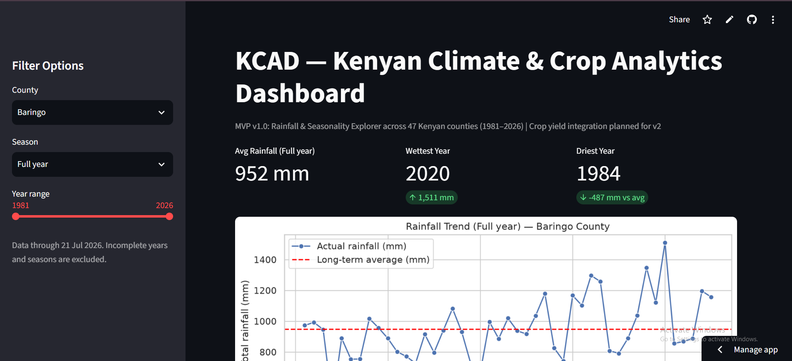
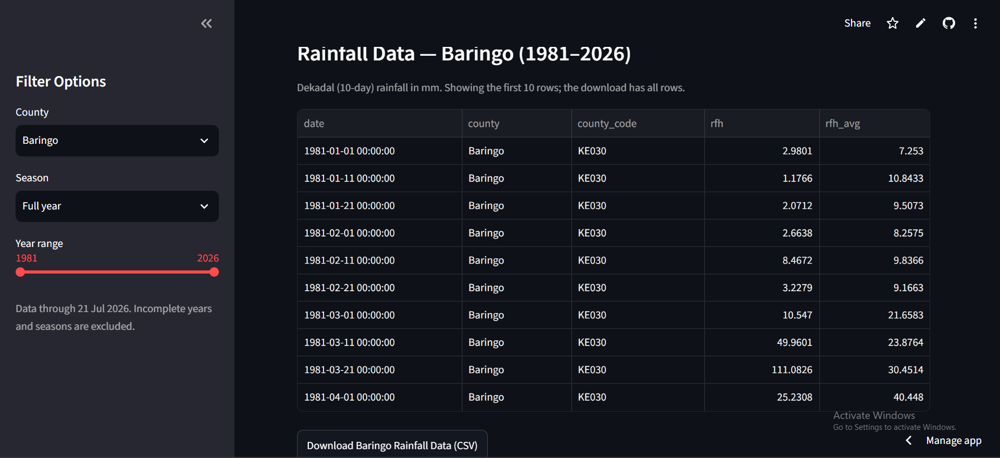

# KCAD — Kenyan Climate & Crop Analytics Dashboard

An interactive dashboard for exploring 45 years of rainfall across all 47 Kenyan counties, built for people who want to see climate patterns without GIS software or statistical training.

**Live app:** https://kcad-kenya-rainfall.streamlit.app




## What it does

- Pick any of the 47 counties and a year range (1981 onwards)
- Switch between the full year, the long rains (Mar–May) and the short rains (Oct–Dec)
- See average rainfall, the wettest year and the driest year at a glance
- Compare actual rainfall with the long-term average, year by year
- See how far each year was above or below average, as a percentage
- View the average monthly pattern, with Kenya's two typical rainy seasons shaded
- Download the filtered county data as CSV

## How it works

The project has two parts: a data preparation script and the dashboard.

`prepare_data.py` turns the raw HDX file into one clean county-level dataset:

1. Keep only admin level 2 rows with `version == "final"` (provisional estimates are excluded)
2. Read the county code from the first five characters of the PCODE (for example `KE030`)
3. Combine a county's admin units into one county series, weighted by pixel count
4. Attach county names from a lookup table
5. Validate the result: 47 counties, no missing names, no duplicate county-dekad rows, no missing rainfall values

`app.py` loads the prepared file and draws the dashboard with Streamlit, Matplotlib and Seaborn.

## Methodology notes

- **Dekads.** The source data is dekadal (10-day periods): three per month, 36 per year. Rainfall values are in millimetres per dekad.
- **Complete periods only.** A year (or a 3-month season) is shown only if all of its dekads are present, so a partly recorded period never looks like a dry one. The same rule applies to the monthly chart, which uses only months with all three dekads.
- **Weighted county averages.** Some counties are made up of several admin units of very different sizes. Averaging them equally distorts the result, so units are weighted by their pixel count (`n_pixels`), a proxy for area. For a few counties this changes annual totals by more than 10% compared with a simple average.
- **Long-term average.** The `rfh_avg` column comes from the HDX dataset. According to the HDX HAPI documentation for this series, the baseline period is 1989–2018. It is combined to county level with the same pixel weights as rainfall and is the baseline for the anomaly chart.
- **Anomaly.** Calculated as (actual − long-term average) / long-term average × 100.

## Run it locally

Built with Python 3.13.

```
git clone https://github.com/ALBERTM06/KCAD.git
cd KCAD
python -m venv venv
venv\Scripts\activate        # Windows (Command Prompt)
.\venv\Scripts\Activate.ps1  # Windows (PowerShell)
source venv/bin/activate     # macOS/Linux
python -m pip install -r requirements.txt
python -m streamlit run app.py
```

The prepared dataset (`data/kenya_county_rainfall.csv`) is included. To rebuild it, download the two raw files into `data/raw/` and run `python prepare_data.py`:

- `ken-rainfall-subnat-full.csv` from the HDX dataset below
- `locations.csv` from the kenya_locations repository below

## Project structure

```
app.py                         Streamlit dashboard
prepare_data.py                Raw data to county-level dataset
requirements.txt
data/kenya_county_rainfall.csv Prepared dataset used by the app
data/raw/                      Raw inputs (not committed)
docs/                          App screenshots used in this README
README.md
```

## Limitations

- Rainfall only in this version. Temperature and crop yield data are planned for v2.
- Pixel-count weighting approximates area weighting; it is not exact.
- County values follow WFP's admin units, which do not perfectly match official boundaries.
- The shaded rainy seasons show Kenya's typical pattern. A few western and Rift Valley highland counties (for example Nandi, Trans Nzoia and Uasin Gishu) get a large share of their rain outside those months.
- Data after the latest complete dekad is not available, so the current year is incomplete.

## Data sources

- World Food Programme & Climate Hazards Center, UC Santa Barbara. *Kenya: Rainfall indicators at subnational level* (computed from CHIRPS v2). Published on the Humanitarian Data Exchange. https://data.humdata.org/dataset/ken-rainfall-subnational (licence terms on the dataset page)
- kenya-eie-wg. *kenya_locations* (PCODE-to-county lookup). https://github.com/kenya-eie-wg/kenya_locations

## Author

Albert Karoki Miricho — Computer Science, Strathmore University

